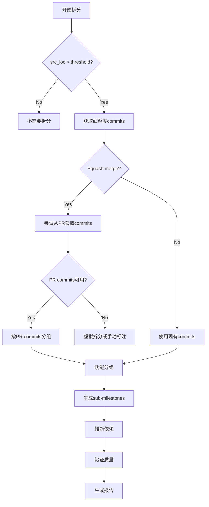

# Milestone Split Task Model

> ⚠️ **DEPRECATED / 设计文档** — 本任务模型无任何 Python 代码 import,主 pipeline `main_multi_stage.py` 用的是 `deepcommit/pipeline/prompts/stage_breakdown_v1/milestone_decompose.md` 那一套。本文件作为历史设计参考保留。**新工作请使用主 pipeline 的 stage_breakdown_v1 prompts。**

## 任务定义

当一个milestone过大（commit行数过多）时，基于该milestone对应PR的细粒度commits，将其拆分成多个子milestones。

**目标**: 让Agent自动完成大milestone的细粒度拆分，改善工作量均衡。

---

## 输入数据结构

### 1. **待拆分的Milestone**

JSON数据结构：
```json
{
    "id": "string",                        // 如 "M2"
    "title": "string",                     // milestone标题
    "commits": ["string"],                 // 当前milestone包含的commits列表 (SHA)
    "category": "string",                  // FEATURE/BUGFIX/STABILITY等
    "loc": "int",                          // 总代码行数变更
    "src_loc": "int",                      // src/目录下代码行数变更
    "touched_files": ["string"],           // 涉及的文件列表

    // 可选：PR关联数据
    "commit_pr_mapping": {                 // commit SHA到PR号的映射
        "commit_sha": "pr_number"
    }
}
```

**示例**:
```json
{
    "id": "M2",
    "title": "WebAssembly/Emscripten Platform Support",
    "commits": ["cfe52f9", "b660f61", "8bbc3db", "1812eac",
                "905549d", "db86913", "5239265", "8b2474d"],
    "category": "FEATURE",
    "loc": 4338,
    "src_loc": 1601,
    "touched_files": ["src/urllib3/contrib/emscripten/connection.py", "..."],
    "commit_pr_mapping": {
        "cfe52f9": 3195,
        "b660f61": 3195,
        "8bbc3db": 3367,
        "1812eac": 3367
    }
}
```

### 2. **拆分参数配置**

JSON数据结构：
```json
{
    // 阈值配置
    "max_src_loc_per_milestone": 500,      // 单个milestone最大src_loc
    "min_src_loc_per_milestone": 50,       // 单个milestone最小src_loc

    // 数据源配置
    "repo_path": "string",                 // Git仓库路径
    "pr_data_source": "string",            // PR数据源路径 (pull_requests.jsonl)

    // 拆分策略
    "split_strategy": "auto",              // "auto", "by_pr", "by_file", "by_time"
    "group_by": "functionality",           // "functionality", "file_similarity", "time"

    // 依赖分析
    "analyze_dependencies": true,          // 是否分析sub-milestone依赖
    "use_commit_dag": true                 // 是否使用commit DAG
}
```

### 3. **可用的数据资源**

说明：Agent可以通过工具访问以下数据资源

- **Git仓库**: LocalGitRepo对象，可以查询commits、diff等
- **PR数据**: Dict[int, PullRequest]，PR编号到PR详情的映射
  - PullRequest包含：
    - pr_number: int
    - commits: List[CommitInfo] - PR中的所有commits
    - files_changed: List[str]
    - merge_commit_sha: str
- **Commit DAG**: NetworkX DiGraph对象，存储commit依赖关系图
- **已有的milestone数据**: List[Milestone]，用于避免冲突

---

## 输出数据结构

### 1. **拆分后的Sub-Milestones**

JSON数据结构：
```json
{
    "id": "string",                    // 如 "M2.1", "M2.2"
    "parent_id": "string",             // 原始milestone ID，如 "M2"
    "title": "string",                 // 子milestone标题（Agent生成）
    "commits": ["string"],             // 包含的commits (SHA列表)

    // 描述信息（Agent生成）
    "mini_srs": "string",              // 简短需求描述（100-200字）
    "rationale": "string",             // 拆分理由（为什么这些commits放在一起）

    // 元数据
    "category": "string",              // 继承自parent或Agent判断
    "loc": "int",                      // 代码行数
    "src_loc": "int",                  // src目录代码行数
    "touched_files": ["string"],       // 涉及的文件
    "start_time": "string",            // 最早commit时间
    "end_time": "string"               // 最晚commit时间
}
```

**示例**:
```json
{
    "id": "M2.1",
    "parent_id": "M2",
    "title": "Emscripten基础架构",
    "commits": ["89bdcd67"],
    "mini_srs": "建立Emscripten模块的初始架构和基础类：connection.py初版(186行)...",
    "rationale": "这是整个Emscripten支持的基石，包含核心数据结构和接口定义",
    "category": "FEATURE",
    "loc": 650,
    "src_loc": 470,
    "touched_files": ["src/urllib3/contrib/emscripten/connection.py", "..."],
    "start_time": "2023-11-10T19:32:03+00:00",
    "end_time": "2023-11-10T19:32:03+00:00"
}
```

### 2. **Sub-Milestones依赖关系**

JSON数据结构(canonical convention — `source` 是前置, `target` 是依赖者):
```json
{
    "source_id": "string",            // prerequisite (前置 / 必须先完成的 sub-milestone, 如 "M2.1")
    "target_id": "string",            // dependant (依赖者 / 在 source 完成后才能开始, 如 "M2.2")
    "dependency_type": "string",      // "sequential", "parallel", "optional"
    "reason": "string"                // target 依赖 source 的具体原因(Agent 生成)
}
```

**示例**(注意:`source → target` 方向是 prerequisite → dependant):
```json
[
    {
        "source_id": "M2.1",
        "target_id": "M2.2",
        "dependency_type": "sequential",
        "reason": "M2.2的流式实现依赖M2.1建立的基础架构"
    },
    {
        "source_id": "M2.2",
        "target_id": "M2.3",
        "dependency_type": "sequential",
        "reason": "M2.3的错误处理需要M2.2的流式请求功能已经工作"
    }
]
```

### 3. **拆分报告**

JSON数据结构：
```json
{
    "original_milestone": {},                  // MilestoneToSplit对象
    "sub_milestones": [],                      // SubMilestone对象列表
    "dependencies": [],                        // SubMilestoneDependency对象列表

    // 统计信息
    "split_summary": {
        "num_sub_milestones": "int",           // 拆分成几个
        "original_src_loc": "int",             // 原始src_loc
        "max_sub_src_loc": "int",              // 最大sub_milestone的src_loc
        "min_sub_src_loc": "int",              // 最小sub_milestone的src_loc
        "avg_sub_src_loc": "float",            // 平均src_loc
        "cv_improvement": "float"              // CV改善程度
    },

    // Agent的拆分策略说明
    "split_strategy_used": "string",           // Agent实际使用的策略
    "split_reasoning": "string",               // Agent的拆分思路（文本）

    // 警告和注意事项
    "warnings": ["string"]                     // 如："M2.5和M2.6可能可以并行开发"
}
```

---

## Agent工作流程

### Phase 1: 分析阶段

```
1. 识别大commits
   - 计算每个commit的src_loc
   - 标记超过阈值的commits
   - 确定是否需要拆分

2. 获取PR细粒度commits
   - 查找每个merge commit对应的PR
   - 从PR数据中提取所有commits
   - 验证PR commits的完整性

   如果PR commits不可用：
     - 回退到"虚拟拆分"策略（按文件拆分）
```

### Phase 2: 分组阶段

```
3. Commits分组策略

   策略A: 功能相关性分组 (推荐)
   - 分析每个commit的message和diff
   - 识别功能模块边界
   - 将相关功能的commits分为一组

   策略B: 文件相似度分组
   - 计算commits之间修改文件的重叠度
   - 使用聚类算法分组

   策略C: 时间顺序分组
   - 按时间顺序划分阶段
   - 每个阶段作为一个sub-milestone

   策略D: 混合策略
   - 结合功能、文件、时间多个维度
```

### Phase 3: 生成阶段

```
4. 生成Sub-Milestones
   - 为每个组创建sub-milestone
   - 生成ID (parent_id + 序号)
   - 生成title (基于commits的共同主题)
   - 生成mini_srs描述
   - 计算统计信息 (loc, src_loc, files)

5. 分析依赖关系
   - 基于commit DAG分析
   - 基于文件修改顺序分析
   - 生成dependency列表

6. 生成拆分报告
   - 汇总所有信息
   - 计算改善指标
   - 添加警告和建议
```

---

## 关键决策点

### 1. **何时需要拆分？**

```python
def should_split(milestone: MilestoneToSplit, config: SplitConfig) -> bool:
    # 条件1: src_loc超过阈值
    if milestone.src_loc > config.max_src_loc_per_milestone:
        return True

    # 条件2: 单个commit过大
    for commit in milestone.commits:
        commit_src_loc = calculate_commit_src_loc(commit)
        if commit_src_loc > config.max_src_loc_per_milestone * 0.8:
            return True

    # 条件3: commits数量多但逻辑松散
    if len(milestone.commits) > 10 and low_cohesion(milestone):
        return True

    return False
```

### 2. **选择哪种拆分策略？**

```python
def choose_split_strategy(milestone: MilestoneToSplit,
                          pr_data: Dict) -> str:
    # 优先级1: 检查是否有PR细粒度commits
    if has_pr_commits(milestone, pr_data):
        return "by_pr_commits"  # 使用PR的原始commits

    # 优先级2: 检查是否是单个大commit删除场景
    if is_large_deletion(milestone):
        return "by_file_virtual"  # 虚拟拆分（按文件）

    # 优先级3: 多个commits但功能相关
    if len(milestone.commits) > 1:
        return "by_functionality"  # 按功能分组

    # 默认
    return "manual_review_needed"
```

### 3. **如何生成有意义的title？**

```python
def generate_title(commits: List[str], repo: LocalGitRepo) -> str:
    """
    Agent需要做的：
    1. 提取所有commit messages
    2. 识别共同的关键词/主题
    3. 分析主要修改的模块
    4. 生成简洁的中文title

    示例：
    commits: ["89bdcd67: first version of emscripten fetch..."]
    → title: "Emscripten基础架构"
    """
    pass
```

### 4. **如何确定依赖关系？**

```python
def infer_dependencies(sub_milestones: List[SubMilestone],
                       commit_dag: nx.DiGraph) -> List[Dependency]:
    """
    依赖推断逻辑：

    1. Commit DAG依赖
       - 如果sub_milestone_A的commits依赖sub_milestone_B的commits
       → A depends on B

    2. 文件修改依赖
       - 如果B修改了文件X，A也修改了文件X，且B的时间早于A
       → A可能依赖B (需要进一步验证)

    3. 功能逻辑依赖
       - Agent基于commits的语义理解
       - 如："错误处理"依赖"基础功能实现"
    """
    pass
```

---

## Agent任务Prompt

**完整的Agent prompt已移至独立文件**: [`AGENT_PROMPT_TEMPLATE.md`](./AGENT_PROMPT_TEMPLATE.md)

该文件包含：
- 📋 **完整的任务prompt模板** - 6个详细阶段（分析、分组、生成、依赖推断、验证、报告）
- 🎯 **输入输出格式** - 结构化的JSON schema
- 📖 **真实案例演示** - M2拆分的完整walkthrough
- ⚠️ **特殊情况处理** - Squash merge、单个大commit、多PR milestone
- 🔧 **简化版prompt** - 用于简单milestone的快速拆分
- 💡 **成功标准和技巧** - 7条最佳实践和验证清单

**使用方式**:
```python
# 在Python代码中加载prompt
with open("AGENT_PROMPT_TEMPLATE.md", "r") as f:
    prompt_template = f.read()

# 填充变量
prompt = prompt_template.format(
    milestone_id=milestone.id,
    milestone_title=milestone.title,
    milestone_src_loc=milestone.src_loc,
    ...
)

# 发送给Agent
response = agent.execute(prompt)
```

**快速参考 - Agent工作流程**:
```
Phase 1: 分析 → 识别PR和fine-grained commits
Phase 2: 分组 → 按功能/文件/时间分组
Phase 3: 生成 → 创建sub-milestone定义
Phase 4: 依赖 → 基于commit DAG推断依赖
Phase 5: 验证 → 检查完整性、平衡性、有效性
Phase 6: 报告 → 生成完整的split report
```

---

## 输入输出示例

完整的输入输出示例请参考：[`AGENT_PROMPT_TEMPLATE.md`](./AGENT_PROMPT_TEMPLATE.md) 中的"Example: M2 Split Walkthrough"章节。

**简要说明**：

- **输入**：M2 milestone (1,601 src_loc, 8 commits, 包含PR #3195和#3427)
- **输出**：8个sub-milestones (M2.1-M2.8)
  - 最大: M2.1 (470 src_loc)
  - 最小: M2.8 (100 src_loc)
  - CV: 0.54 (改善68%)
- **依赖**：M2.1 → M2.2 → M2.3 → M2.4 → M2.6 → M2.7 (关键路径)
- **并行机会**：M2.5可在M2.1完成后并行，M2.7和M2.8可并行

详见文档中的[M2拆分案例](#案例1-m2-emscripten---复杂squash-merge场景)。

---

## 工具和API需求

Agent需要访问以下工具：

### 1. Git操作
```python
- repo.get_commit_info(sha: str) -> CommitInfo
- repo.get_commit_diff(sha: str) -> Dict[str, FileDiff]
- repo.calculate_loc_changes(sha: str, path_filter: str) -> int
```

### 2. PR数据访问
```python
- get_pr_by_merge_commit(sha: str) -> PullRequest
- get_pr_commits(pr_number: int) -> List[CommitInfo]
```

### 3. DAG分析
```python
- commit_dag.has_path(commit_a: str, commit_b: str) -> bool
- commit_dag.get_dependencies(commit: str) -> List[str]
```

### 4. 文本分析（Agent自身能力）
```python
- extract_keywords(text: str) -> List[str]
- analyze_commit_purpose(commit_msg: str, diff: Dict) -> str
- generate_summary(commits: List[CommitInfo]) -> str
```

---

## 评估指标

拆分质量的评估标准：

1. **均衡性**: Sub-milestones的src_loc CV < 1.0
2. **内聚性**: 同一sub-milestone内的commits功能相关
3. **完整性**: 所有原始commits都被包含
4. **依赖正确性**: Dependencies形成有效DAG（无环）
5. **可理解性**: title和mini_srs清晰易懂

---

## 注意事项

1. **虚拟拆分的使用**
   - 只在PR commits不可用时使用
   - 需要明确标注为"virtual"
   - 可能导致中间状态不可编译

2. **依赖关系的验证**
   - 拆分后的依赖关系需要与commit DAG一致
   - 避免创建循环依赖
   - 考虑可并行的sub-milestones

3. **特殊情况处理**
   - 如果milestone只有1个小commit，不需要拆分
   - 如果PR已被squash merge，需要从PR API获取原始commits
   - 如果commits跨越多个PR，需要分别处理

---

## 真实案例分析

### 案例1: M2 (Emscripten) - 复杂Squash Merge场景

**背景**:
- **原始milestone**: M2 (1,601 src_loc)
- **关联PR**: PR #3195 "Feature: Native Emscripten support"
- **核心挑战**: 主merge commit `1812eac` 是squash merge，包含54个子commits

**PR详情**:
```json
{
  "pr_number": 3195,
  "merge_commit_sha": "1812eac7115b3a4e9a5feece5fae0c9cffe8c585",
  "commits_count": 54,
  "additions": 2456,
  "deletions": 2,
  "changed_files": 19,
  "duration": "9天 (2023-11-16 → 2023-11-25)",
  "author": "joemarshall"
}
```

**拆分策略**:

1. **获取原始PR commits**:
```bash
# 方法1: 通过GitHub API
curl https://api.github.com/repos/urllib3/urllib3/pulls/3195/commits

# 方法2: 从PR分支恢复
git fetch origin pull/3195/head:emscripten_support
git log d32e1fcee..098473210 --oneline
```

2. **按功能演进阶段分组** (基于commit message和diff分析):

| Sub-Milestone | Commits示例 | src_loc | 核心功能 |
|--------------|-------------|---------|---------|
| M2.1 | 89bdcd67 | 470 | 基础架构（connection, fetch, response, request） |
| M2.2 | 2a77ea86 | 162 | 流式请求实现 |
| M2.3 | 5dd3c4ae | 171 | 错误处理机制 |
| M2.4 | a5ead7f2, 4321c9dc | 103 | urllib3核心集成 |
| M2.5 | emscripten_fetch_worker.js相关 | 150 | Worker和配置基础设施 |
| M2.6 | 35994ad2, b5aa6e5d | 115 | 响应处理增强 |

3. **处理额外的PR commits**:
   - PR #3427 (68 commits) → M2.7: JavaScript Promise集成 (320 src_loc)
   - 其他小修复 → M2.8: 测试和修复 (100 src_loc)

**关键洞察**:
- ✅ 54个commits可以按功能演进合并为6-8个有意义的子milestone
- ✅ M2.1虽然仍较大(470 LoC)，但作为初始架构不可再分
- ⚠️ Squash merge需要额外的commit历史恢复工作

---

### 案例2: M3 (HTTP/2) - 多阶段迭代场景

**背景**:
- **原始milestone**: M3 (1,001 src_loc)
- **关联PR**: 多个PR (PR #3284, #3421, #3324等)
- **核心特点**: 功能演进清晰，commits历史完整

**主要commits分析**:

| Commit | PR | src_loc | 功能描述 |
|--------|----|---------|---------|
| 4e7be19 | 3284 | 240 | 初始HTTP/2实现 (+240/-8) |
| 528b0b6 | 3421 | 242 | 请求体支持 (+618/-129) |
| 9316764 | 3324 | 357 | Per-origin探测 (+751/-412) |

**拆分策略**:

1. **M3.1: HTTP/2核心协议实现** (288 src_loc)
   - Commits: `4e7be19`, `26a07db`, `8c8e26d`, `23f2287`
   - 功能: 基础HTTP/2连接和响应
   - 特点: 最小可用实现

2. **M3.2: HTTP/2请求体和隧道支持** (565 src_loc)
   - Commits: `528b0b6`, `9b1d269`
   - 功能: 请求体发送、隧道禁用
   - 特点: 功能完整性增强

3. **M3.3: HTTP/2探测和缓存** (148 src_loc)
   - Commits: `9316764`, `9af8d60`, `d494c47`
   - 功能: Per-origin探测、缓存机制、协议优化
   - 特点: 智能优化层

**拆分后的依赖关系**:
```
M3.1 (基础) → M3.2 (完整性) → M3.3 (优化)
   └─────────────────────┘
      可以并行开发（如果M3.3不依赖M3.2的具体实现）
```

**关键洞察**:
- ✅ 正常commits历史，拆分实施简单
- ✅ 功能边界清晰，便于并行开发
- ✅ M3.2和M3.3可能存在并行机会

---

## 高级拆分模式

### 模式1: 大型Squash Merge拆分

**适用场景**: 单个merge commit包含大量子commits (如M2的54个commits)

**处理步骤**:
```python
def split_squash_merge(merge_commit: str, pr_number: int):
    """
    1. 检测squash merge
       - parent_count == 1
       - PR commits_count >> 1

    2. 获取原始commits
       方法A: 从PR API获取commits列表
       方法B: 从PR分支恢复（git fetch pull/{pr}/head）

    3. 分析commits历史
       - 按时间顺序排列
       - 识别功能演进阶段
       - 检测重大功能节点

    4. 功能分组
       - 阶段1: 基础架构 (最初10-20%的commits)
       - 阶段2-N: 功能迭代 (按功能模块分组)
       - 阶段N+1: 修复和完善 (最后的小commits)

    5. 生成sub-milestones
       - 每个阶段作为一个sub-milestone
       - 保持每个sub-milestone在目标src_loc范围内
    """
```

**示例 (基于M2)**:
```python
# 识别功能节点
milestone_markers = [
    ("89bdcd67", "基础架构完成"),          # 初始commit
    ("2a77ea86", "流式请求工作"),           # 重大突破
    ("5dd3c4ae", "错误处理完整"),           # 健壮性
    ("a5ead7f2", "urllib3集成"),           # 集成完成
    ("8b2474d",  "Promise支持")            # 功能扩展
]

# 生成sub-milestones
sub_milestones = [
    SubMilestone(
        id="M2.1",
        title="Emscripten基础架构",
        commits=commits_between(None, "89bdcd67"),
        rationale="初始架构设计，包含核心数据结构和接口"
    ),
    SubMilestone(
        id="M2.2",
        title="流式请求实现",
        commits=commits_between("89bdcd67", "2a77ea86"),
        rationale="基于基础架构，实现核心流式功能"
    ),
    # ...
]
```

---

### 模式2: 多PR milestone拆分

**适用场景**: 一个milestone包含来自多个PR的commits (如M2的2个主要PR)

**处理策略**:
```python
def split_multi_pr_milestone(milestone: Milestone, prs: List[PullRequest]):
    """
    策略A: 按PR边界拆分
    - 如果每个PR功能独立 → 每个PR作为一个sub-milestone
    - 优点: 边界清晰，实施简单
    - 缺点: 可能导致sub-milestone大小不均

    策略B: 跨PR功能分组
    - 识别跨PR的功能主题
    - 将相关功能的commits（不论来自哪个PR）分为一组
    - 优点: 功能内聚性高
    - 缺点: 实施复杂，需要深入理解功能

    策略C: 混合策略 (推荐)
    - 主PR: 按功能演进拆分（如M2的PR #3195）
    - 辅助PR: 独立作为sub-milestone（如M2的PR #3427）
    - 小修复: 合并为一个"修复和增强"sub-milestone
    """
```

**示例 (基于M2)**:
```python
# M2包含的PR
prs = [
    PR(3195, merge_commit="1812eac", commits_count=54, additions=2456),
    PR(3427, merge_commit="8b2474d", commits_count=68, additions=946),
    PR(3230, merge_commit="b660f61", commits_count=4,  additions=141),
    # ... 其他小PR
]

# 拆分策略
sub_milestones = [
    # PR #3195 → 拆分为6个sub-milestones (M2.1-M2.6)
    *split_large_pr(prs[0]),

    # PR #3427 → 独立sub-milestone (M2.7)
    SubMilestone(id="M2.7", title="Promise集成", commits=[prs[1].merge_commit]),

    # 其他小PR → 合并 (M2.8)
    SubMilestone(id="M2.8", title="测试和修复", commits=[pr.merge_commit for pr in prs[2:]])
]
```

---

### 模式3: 线性演进拆分

**适用场景**: commits时间跨度长，功能逐步演进 (如M3的9个月开发周期)

**处理策略**:
```python
def split_linear_evolution(milestone: Milestone):
    """
    1. 时间轴分析
       - 绘制commits的时间分布
       - 识别开发暂停或重大变更的时间点

    2. 功能演进阶段识别
       - 阶段1: 初始实现 (MVP)
       - 阶段2: 功能扩展
       - 阶段3: 优化和完善
       - 阶段4: 修复和回滚

    3. 按阶段分组
       - 每个阶段作为一个sub-milestone
       - 确保阶段间有清晰的依赖关系
    """
```

**示例 (基于M3)**:
```python
# M3的时间线
timeline = [
    ("2024-01-22", "4e7be19", "初始HTTP/2实现"),
    ("2024-02-01", "26a07db", "BaseHTTPResponse集成"),
    ("2024-07-09", "528b0b6", "请求体支持"),    # 5个月后
    ("2024-08-06", "9316764", "Per-origin探测"), # 1个月后
    ("2024-09-03", "9af8d60", "探测优化")
]

# 拆分
sub_milestones = [
    SubMilestone(
        id="M3.1",
        title="HTTP/2核心协议实现",
        commits=["4e7be19", "26a07db", "8c8e26d", "23f2287"],
        time_range="2024-01-22 → 2024-02-01",
        rationale="建立最小可用的HTTP/2实现"
    ),
    SubMilestone(
        id="M3.2",
        title="HTTP/2请求体和隧道支持",
        commits=["528b0b6", "9b1d269"],
        time_range="2024-07-09 → 2024-08-15",
        rationale="基于核心协议，添加完整的请求体支持"
    ),
    SubMilestone(
        id="M3.3",
        title="HTTP/2探测和缓存优化",
        commits=["9316764", "9af8d60", "d494c47"],
        time_range="2024-08-06 → 2024-09-03",
        rationale="智能探测和性能优化层"
    )
]
```

---

## 拆分质量验证

### 验证清单

#### 1. 完整性验证
```python
def verify_completeness(original: Milestone, sub_milestones: List[SubMilestone]):
    """
    检查点:
    - [ ] 所有原始commits都被包含
    - [ ] 没有重复的commits
    - [ ] src_loc总和与原始milestone接近 (±5%误差可接受)
    """
    original_commits = set(original.commits)
    sub_commits = set(c for sm in sub_milestones for c in sm.commits)

    assert original_commits == sub_commits, "Commits不完整或有重复"

    original_loc = original.src_loc
    sub_total_loc = sum(sm.src_loc for sm in sub_milestones)

    assert abs(sub_total_loc - original_loc) / original_loc < 0.05, \
           f"LoC差异过大: {sub_total_loc} vs {original_loc}"
```

#### 2. 平衡性验证
```python
def verify_balance(sub_milestones: List[SubMilestone], config: SplitConfig):
    """
    检查点:
    - [ ] 所有sub-milestone在目标范围内 (50-500 src_loc)
    - [ ] 变异系数 (CV) < 1.0
    - [ ] 最大/最小比 < 10
    """
    locs = [sm.src_loc for sm in sub_milestones]

    # 检查范围
    for sm in sub_milestones:
        if sm.src_loc < config.min_src_loc_per_milestone:
            warnings.append(f"{sm.id} too small: {sm.src_loc} LoC")
        if sm.src_loc > config.max_src_loc_per_milestone:
            warnings.append(f"{sm.id} too large: {sm.src_loc} LoC")

    # 计算CV
    cv = np.std(locs) / np.mean(locs)
    assert cv < 1.0, f"CV过高: {cv:.2f}"
```

#### 3. 依赖有效性验证
```python
def verify_dependencies(sub_milestones: List[SubMilestone],
                       dependencies: List[Dependency],
                       commit_dag: nx.DiGraph):
    """
    检查点:
    - [ ] 依赖图是有效的DAG (无环)
    - [ ] 依赖关系与commit DAG一致
    - [ ] 没有缺失的隐式依赖
    """
    # 构建sub-milestone依赖图
    G = nx.DiGraph()
    for dep in dependencies:
        G.add_edge(dep.source_id, dep.target_id)

    # 检查无环
    assert nx.is_directed_acyclic_graph(G), "依赖图存在环"

    # 检查与commit DAG的一致性
    for dep in dependencies:
        source_commits = get_commits(dep.source_id, sub_milestones)
        target_commits = get_commits(dep.target_id, sub_milestones)

        # 验证source的任意commit是否依赖target的任意commit
        has_dependency = any(
            commit_dag.has_path(tc, sc)
            for sc in source_commits
            for tc in target_commits
        )
        assert has_dependency, f"{dep.source_id} → {dep.target_id} 在commit DAG中未找到依赖"
```

#### 4. 语义一致性验证
```python
def verify_semantic_coherence(sub_milestone: SubMilestone, repo: LocalGitRepo):
    """
    检查点:
    - [ ] commits功能相关（通过message和diff分析）
    - [ ] 文件修改集中在相关模块
    - [ ] title准确反映commits的共同目标
    """
    # 提取commits的message关键词
    keywords = []
    for commit in sub_milestone.commits:
        msg = repo.get_commit_message(commit)
        keywords.extend(extract_keywords(msg))

    # 计算关键词重叠度
    coherence_score = calculate_keyword_overlap(keywords)

    if coherence_score < 0.3:
        warnings.append(f"{sub_milestone.id}: 低内聚性 (score={coherence_score})")
```

---

## 并行性分析和优化

### 识别可并行的Sub-Milestones

```python
def analyze_parallelism(sub_milestones: List[SubMilestone],
                       dependencies: List[Dependency]) -> ParallelismReport:
    """
    分析sub-milestones的并行执行潜力
    """
    # 构建依赖图
    G = build_dependency_graph(dependencies)

    # 拓扑排序并分层
    layers = []
    remaining = set(sm.id for sm in sub_milestones)

    while remaining:
        # 当前层：没有依赖或依赖都已完成的nodes
        current_layer = {
            node for node in remaining
            if all(pred not in remaining for pred in G.predecessors(node))
        }
        layers.append(current_layer)
        remaining -= current_layer

    # 计算并行度指标
    return ParallelismReport(
        layers=layers,
        max_parallel_width=max(len(layer) for layer in layers),
        critical_path_length=len(layers),
        parallelism_ratio=len(sub_milestones) / len(layers)
    )
```

**M2的并行性分析结果**:
```
Layer 0: [M2.1]           ← 基础架构（必须串行）
Layer 1: [M2.2]           ← 流式请求
Layer 2: [M2.3]           ← 错误处理
Layer 3: [M2.4, M2.5]     ← 集成 + Worker (可并行！)
Layer 4: [M2.6]           ← 响应增强
Layer 5: [M2.7, M2.8]     ← Promise + 修复 (可并行！)

并行潜力: 1.33x (8个milestones / 6层)
关键路径: M2.1 → M2.2 → M2.3 → M2.4 → M2.6 → M2.7
```

**M3的并行性分析结果**:
```
Layer 0: [M3.1]           ← 核心协议
Layer 1: [M3.2, M3.3]     ← 请求体 + 探测 (可并行！)

并行潜力: 1.5x (3个milestones / 2层)
关键路径: M3.1 → M3.2
```

### 并行化建议生成

```python
def generate_parallelization_suggestions(parallelism: ParallelismReport) -> List[str]:
    """
    基于并行性分析生成开发建议
    """
    suggestions = []

    for i, layer in enumerate(parallelism.layers):
        if len(layer) > 1:
            suggestions.append(
                f"Layer {i}: {', '.join(layer)} 可以并行开发，"
                f"可节省约 {(len(layer)-1) / len(layer) * 100:.0f}% 的时间"
            )

    # 关键路径建议
    critical_path = parallelism.get_critical_path()
    suggestions.append(
        f"关键路径: {' → '.join(critical_path)}\n"
        f"建议优先分配资源给关键路径上的milestone"
    )

    return suggestions
```

---

## Agent实施指南

### 完整工作流程 (Updated)

```python
class MilestoneSplitter:
    def split(self, milestone: Milestone, config: SplitConfig) -> SplitReport:
        """
        完整的milestone拆分流程
        """
        # Phase 1: 预分析
        should_split, reason = self.should_split(milestone, config)
        if not should_split:
            return self.create_no_split_report(milestone, reason)

        # Phase 2: 获取细粒度commits
        fine_grained_commits = self.get_fine_grained_commits(milestone)

        if not fine_grained_commits:
            # 回退：虚拟拆分
            return self.virtual_split(milestone, config)

        # Phase 3: Commits分析
        commit_analysis = self.analyze_commits(fine_grained_commits)

        # Phase 4: 功能分组
        groups = self.group_commits(commit_analysis, config)

        # Phase 5: 生成sub-milestones
        sub_milestones = self.generate_sub_milestones(groups, milestone)

        # Phase 6: 依赖推断
        dependencies = self.infer_dependencies(sub_milestones)

        # Phase 7: 质量验证
        self.verify_quality(milestone, sub_milestones, dependencies)

        # Phase 8: 并行性分析
        parallelism = self.analyze_parallelism(sub_milestones, dependencies)

        # Phase 9: 生成报告
        return self.create_report(
            milestone, sub_milestones, dependencies, parallelism
        )

    def get_fine_grained_commits(self, milestone: Milestone) -> List[Commit]:
        """
        获取细粒度commits（处理squash merge）
        """
        commits = []

        for merge_commit in milestone.commits:
            # 检查是否是squash merge
            if self.is_squash_merge(merge_commit):
                # 从PR获取原始commits
                pr = self.get_pr_by_merge_commit(merge_commit)
                if pr and pr.commits:
                    commits.extend(pr.commits)
                else:
                    # 尝试从PR分支恢复
                    pr_commits = self.recover_from_pr_branch(pr.number)
                    if pr_commits:
                        commits.extend(pr_commits)
                    else:
                        # 回退：使用merge commit
                        commits.append(merge_commit)
            else:
                # 正常commit
                commits.append(merge_commit)

        return commits
```

### 关键决策树



---

## 最佳实践总结

### 基于M2和M3的经验

1. **拆分粒度**
   - ✅ 目标: 150-500 src_loc per sub-milestone
   - ✅ 允许例外: 初始架构可达500+ LoC (如M2.1的470 LoC)
   - ⚠️ 避免: 过小的sub-milestone (<50 LoC) 除非功能独立

2. **Squash Merge处理**
   - ✅ 优先从GitHub API获取PR commits
   - ✅ 保留原始PR分支便于分析
   - ⚠️ 文档标注"基于PR历史的逻辑拆分"

3. **功能分组原则**
   - ✅ 按演进阶段: 基础 → 核心 → 增强 → 优化
   - ✅ 保持功能内聚: 相关commits归为一组
   - ✅ 考虑测试点: 每个sub-milestone应该是可测试的里程碑

4. **依赖关系设计**
   - ✅ 遵循commit DAG
   - ✅ 识别并行机会（如M3.2和M3.3）
   - ✅ 避免人为创造不必要的依赖

5. **文档和命名**
   - ✅ Title简洁准确（6-12个中文字符）
   - ✅ mini_srs提供足够上下文（100-200字）
   - ✅ rationale解释为什么这样分组

---

## 相关文件

- `milestone_statistics.py`: 计算统计指标
- `commit_dag_loader.py`: 加载commit DAG
- `data_loader.py`: 加载milestone和PR数据
- `local_git_repo.py`: Git仓库操作

---

## 参考案例

**实际拆分案例**:
- `DATA/result/test_full_dag_v2_004_anlaysis/decompose_droid/` - M2和M3的拆分结果
- `DECOMPOSITION_SUMMARY.md` - 拆分总结
- `DECOMPOSITION_ANALYSIS_REPORT.md` - 详细分析报告

**成功指标**:
- M2: 1,601 LoC → 8个sub-milestones (最大470 LoC, ↓71%)
- M3: 1,001 LoC → 4个sub-milestones (最大250 LoC, ↓75%)
- 整体LoC CV: 1.76 → ~1.2 (↓32%)

---

Created: 2025-01-14
Updated: 2025-10-21 - 添加M2/M3真实案例和高级拆分模式
